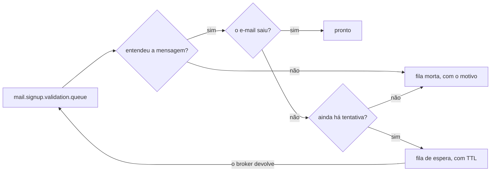

# mail-api

O serviço de e-mail do Codeflix. Ele consome os pedidos que a `subscription-api` publica e entrega
a mensagem — hoje, um tipo só: a validação de cadastro.

Go 1.27, sem framework. Nenhuma porta aberta: o serviço não atende requisição, ele consome fila.

| | |
|---|---|
| Entrada | `mail.signup.validation.queue`, no RabbitMQ |
| Saída | SMTP |
| Destino | **Mailpit, um coletor local** — é prova de conceito, não há provedor de verdade |

## Por que é um serviço à parte

Porque entregar e-mail não é assunto de quem cadastra. A `subscription-api` publica o pedido e segue;
se o servidor de e-mail estiver fora do ar, o cadastro não deixa de funcionar — a mensagem espera na
fila. E o dia em que houver provedor de verdade, com chave de API e limite de envio, nada disso
chega perto do serviço que guarda contas.

O preço está dito: **enquanto este serviço não estiver rodando, ninguém conclui um cadastro**, porque
o link de validação não chega. Em desenvolvimento dava para pescá-lo na fila pelo painel do broker;
agora ele chega no Mailpit, que é uma caixa de entrada de verdade para olhar.

## Como rodar

```bash
docker compose up -d rabbitmq mailpit     # da raiz do monorepo
make run                                  # o serviço, no host
```

A caixa de entrada fica em `http://localhost:${MAILPIT_UI_PORT}` — é lá que o e-mail de validação
aparece, com o link clicável.

Para rodar em container também:

```bash
docker compose up -d mail-api             # da raiz do monorepo; a imagem compila sozinha
```

```bash
make check    # vet e testes com -race; a porta de entrada de cada commit
make test     # só os testes
make fmt      # formata
```

## O contrato com a subscription-api

Três campos, e nada mais:

```json
{ "to": "assinante@codeflix.com.br", "firstname": "Tarcisio",
  "confirmationUrl": "https://codeflix.test/cadastro/confirmar?token=…" }
```

**O link vem montado.** Este serviço não sabe o que é um token, nem qual rota confirma o cadastro,
nem que existe tabela de cadastro pendente — ele recebe um endereço, um nome e um link. É o que
permite a `subscription-api` mudar a rota de confirmação sem tocar aqui.

Os nomes dos campos são contrato, e estão no `SignUpValidationMessage` do outro lado. Errar um deles
não daria erro: daria um e-mail sem destinatário. Por isso há teste recusando a mensagem quando o
campo tem outro nome.

**O primeiro nome pode faltar**, e aí o e-mail cumprimenta sem nome. Descartar um cadastro de verdade
por causa de uma saudação seria pior.

## O e-mail

Texto puro, sem HTML. Não é economia: é o que não quebra em cliente nenhum, não pede imagem externa
e não dá margem a o link clicável apontar para um lugar diferente do que está escrito — que é
justamente a dúvida de quem recebe um e-mail pedindo para clicar.

A mensagem diz que **ignorar é seguro**, porque nenhuma conta nasce sem a confirmação. Quem recebeu
sem ter pedido não precisa fazer nada.

## Quando a entrega falha



**Mensagem que não dá para entender não volta para a fila.** Repetir não a conserta, e devolvê-la a
faria voltar para sempre — ela vai direto para a fila morta, com o motivo num cabeçalho. O corpo não
é alterado: quem olhar a fila morta tem de ver o que a `subscription-api` publicou, não uma versão
nossa dele.

**Falha de entrega é outra coisa.** Servidor de e-mail fora do ar é passageiro, então a mensagem
volta pela escada de tentativas: 1s, 2s, 4s, 8s, 16s, e depois a fila morta. Cinco tentativas
toleram meio minuto de servidor fora do ar — mais que isso não ajuda: o link vale 24 horas, mas quem
se cadastrou está olhando a tela agora.

O atraso vem de uma **fila de espera com TTL**, e não de um `sleep`: a mensagem fica no broker e ele
a devolve sozinho ao expirar. Dormindo, o operário ficaria preso sem fazer nada.

A fila morta não tem consumidor, e é de propósito: ela existe para alguém olhar. Sem ela, mensagem
que esgotou as tentativas desapareceria, e um cadastro que nunca recebeu e-mail não deixaria rastro.

## O endereço não vai para o log

O log é lido por muita gente e indexado na pilha de observabilidade; o e-mail de quem se cadastrou
não precisa estar lá. O que identifica a mensagem no log é a tentativa — quem precisar do endereço
acha na fila morta, que é onde ele faz falta.

## O que este serviço não faz

- **Não autentica no SMTP.** O destino é um coletor local que não pede credencial. Autenticação entra
  junto do provedor de verdade, com TLS, e não antes.
- **Não guarda nada.** Não há banco: a fila é o estado.
- **Não manda outro tipo de e-mail.** Quando houver um segundo, entra um `switch` por tipo de
  mensagem; com um só, isso seria cerimônia.
