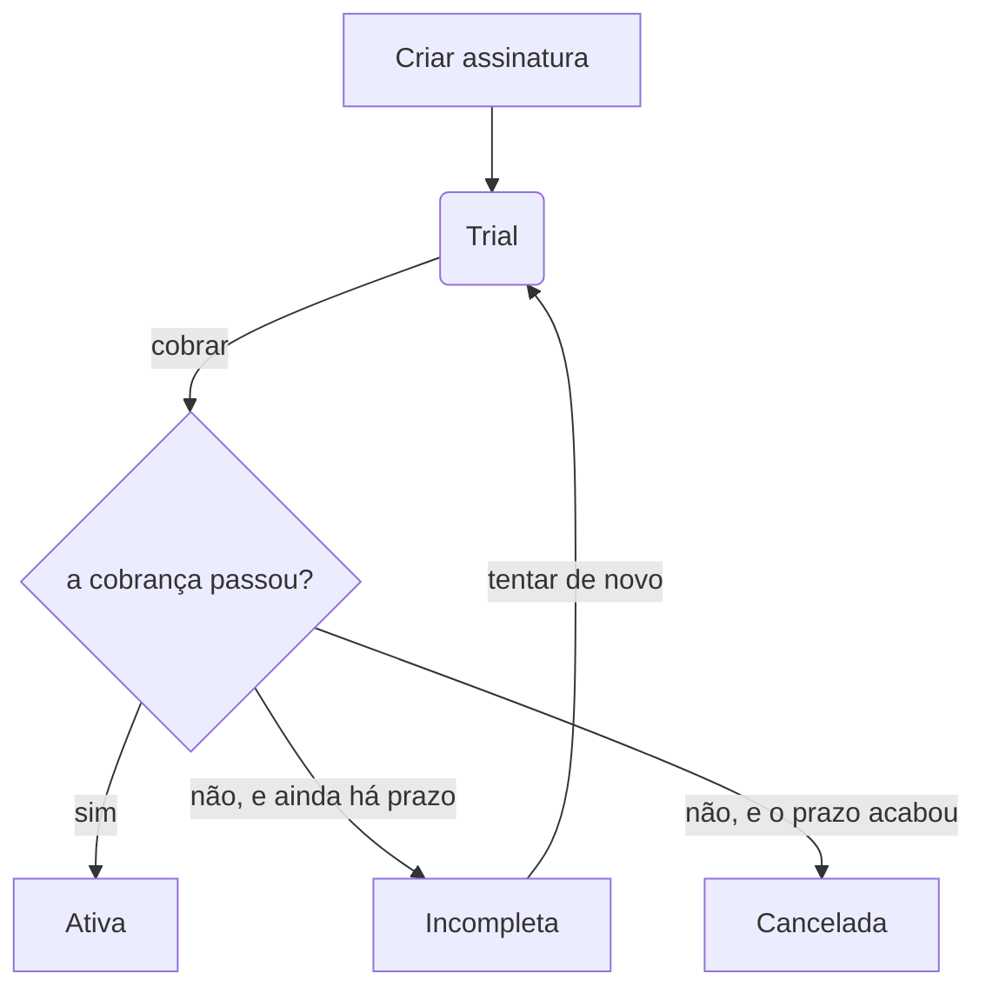
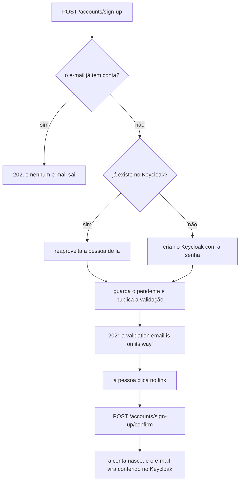

# subscription-api

O serviço de assinaturas do Codeflix: quem é o assinante, qual plano ele escolheu e se a cobrança
daquele mês passou. É ele que decide se alguém tem direito ao catálogo — a `videos-api` só serve o
que já está publicado, e nunca pergunta nada sobre pagamento.

Java 25, Spring Boot 4.1.1, Gradle 9.7.1. Pacote base `com.tarcisiolzbraga.codeflix.subscription`,
porta **8084**.

| | |
|---|---|
| Banco | MySQL 8.4 próprio, na porta 3307 |
| Persistência | JDBC com SQL escrito à mão, sem ORM |
| Autenticação | o mesmo realm do Keycloak dos outros serviços |
| Eventos | fila de saída no banco, lida pelo Debezium |

## O ciclo de vida de uma assinatura



A assinatura nasce em **trial** e vence em um mês. Na cobrança, passando, ela vira **ativa** e o
vencimento anda mais um mês; falhando, ela fica **incompleta** enquanto houver prazo de tolerância, e
é **cancelada** quando ele acaba. Cada passagem de estado registra um evento de domínio.

## Como rodar

A infraestrutura é a do monorepo, com o `.env` da raiz. Deste serviço o compose sobe dois
containers: a aplicação e o banco dela.

```bash
docker compose up -d subscription-mysql keycloak    # da raiz do monorepo
./gradlew bootRun                                   # a API, na 8084
```

Para rodar a aplicação em container também, empacote o jar antes — a imagem não compila:

```bash
./gradlew bootJar
docker compose up -d subscription-api               # da raiz do monorepo
```

```bash
./gradlew build                 # compila e roda tudo; porta de entrada de cada commit
./gradlew unitTests             # só os que não sobem container (dispensa Docker)
./gradlew integrationTests      # só @IntegrationTest
./gradlew e2eTests              # só @E2ETest
./gradlew bootJar               # build/libs/application.jar, na raiz do serviço
```

## A coleção de requisições

`.postman/subscription-api-codeflix.postman_collection.json` é a regressão manual da API, e só vale
completa: rota nova entra nela no mesmo trabalho. Rode a pasta `0. Autenticação` primeiro — ela
guarda o token nas variáveis da coleção, e as outras o usam.

Preencha `clientSecret` com o `KEYCLOAK_CLIENT_SECRET` do `.env`; o arquivo versionado vai com o
campo vazio.

Como não há remoção de plano, a coleção não limpa o que cria: rodar de novo acrescenta planos, sem
quebrar nada e sem depender do que ficou da execução anterior.

## Por que banco próprio

O MySQL da `admin-api` já existe, já tem binlog ligado e já tem o usuário do Debezium: um schema a
mais nele teria saído de graça. Ainda assim o banco aqui é outro container, pelo mesmo motivo que
levou o codificador a ter o Postgres dele:

- **O estado de um serviço não é assunto do outro.** Com um banco só, uma migration daqui alcança as
  tabelas de lá, e um `flyway clean` desatento apaga o catálogo inteiro.
- **Derrubar um não derruba o outro.** O banco da assinatura pode reiniciar, encher ou travar sem
  levar a administração do catálogo com ele.
- **O conector do Debezium fica menor.** Cada banco tem o seu, com a sua lista de tabelas, e o
  tópico de um não mistura evento do outro.

O preço está declarado: um container, um volume e um conector a mais, e o `CDC_USER` do `.env` passa
a ser criado nos dois bancos.

## Persistência sem ORM

Os agregados são salvos por SQL escrito à mão, com o `JdbcClient` do Spring. Não há entidade
espelhando a tabela nem contexto de persistência: o repositório lê o `ResultSet` direto para dentro
do agregado, pelo `with(...)` dele.

Duas consequências que valem registrar, porque mordem:

- **O lock otimista é explícito.** Cada tabela tem uma coluna `version`, e o update termina em
  `WHERE id = :id AND version = :version`. Zero linhas afetadas significa que alguém escreveu antes,
  e não que o id não existe.
- **Escrita precisa de commit.** O pool entrega a conexão com `auto-commit` **ligado**, ao contrário
  do da `admin-api`: lá o Hibernate abre transação em toda escrita, e aqui não há quem o faça. Com o
  auto-commit desligado, um update solto seria desfeito ao devolver a conexão, sem erro no log.
  Escrita que toca mais de uma tabela — o agregado mais a fila de eventos — declara `@Transactional`,
  e aí o gerenciador de transação desliga o auto-commit pelo tempo dela.

## Migrações

Mudança de schema é migration Flyway em `infrastructure/src/main/resources/db/migration`, nomeada
`V<n>__<descricao_em_snake_case>.sql`. O Flyway roda na subida da aplicação, pelo starter do Boot —
não há task `flywayMigrate` separada como na referência do curso.

Nunca editar migration já commitada: o checksum muda e o Flyway para em estado de reparação. O
ajuste é uma migration nova.

## O cadastro



| Rota | Quem alcança | O que faz |
|---|---|---|
| `POST /accounts/sign-up` | qualquer um, sem token | pede o cadastro. Responde **202** e a **mesma** mensagem sempre |
| `POST /accounts/sign-up/confirm` | qualquer um, sem token | confirma com o token do e-mail. É aqui que a conta nasce |

As duas são abertas porque não poderiam ser outra coisa: quem se cadastra ainda não tem usuário no
Keycloak para pedir token, e quem clica no link também não — é justamente a confirmação que marca o
e-mail como conferido.

### A resposta é sempre igual, de propósito

E-mail novo, e-mail que já existe no Keycloak e e-mail que já tem conta recebem **202 com a mesma
mensagem**. Qualquer diferença contaria a um estranho se um endereço está cadastrado. É por isso que
o caso de uso de cadastrar não devolve nada: o controller não tem como responder diferente por
acidente.

Quem pede o cadastro com o e-mail de outra pessoa não avança: a validação vai para a caixa de
entrada **dela**, e sem o token não há confirmação. E não se cria usuário quando o e-mail já existe
no Keycloak, então **ninguém sobrescreve a senha de outro** se cadastrando com o endereço dele.

### O token

Sorteado com `SecureRandom`, 32 bytes, em base64 de URL. O banco guarda só o **resumo SHA-256** — um
vazamento de leitura do banco não entrega confirmação de cadastro alheio. O que vai no e-mail é o
token em claro, e ele vive 24 horas.

Pedir o cadastro de novo é legítimo, porque a mensagem pode não ter chegado: o pedido novo apaga os
pendentes não confirmados daquele e-mail, então **só o link mais novo vale**.

Clicar no link duas vezes devolve a **mesma conta**, e não um erro.

### Por que a conta é gravada antes do pendente

A ordem é escolhida para que interrupção no meio se conserte por repetição, e não por intervenção.
Morrendo o processo entre as duas gravações, sobra conta sem confirmação — e repetir reconhece esse
estado e termina o serviço. Na ordem inversa sobraria pendente confirmado sem conta, com o token já
gasto, e a pessoa ficaria travada.

Por isso não há transação envolvendo as duas escritas: ela também não cobriria a chamada ao
Keycloak, que vem depois e não participa de transação de banco.

### Quem envia o e-mail

Não é este serviço. Ele publica o pedido em `mail.events` com a routing key
`mail.signup.validation`, e a mensagem leva o endereço, o primeiro nome e o **link pronto**. Quem
entrega é um serviço de e-mail próprio, que ainda não existe — então, hoje, a mensagem fica na fila.

Para experimentar à mão: suba o RabbitMQ, faça o cadastro, e pegue o link em
`mail.signup.validation.queue` pelo painel do broker, na 15672.

O link aponta para a página do front (`SIGNUP_CONFIRMATION_URL`), não para uma rota desta API: é o
front que chama o `POST` de confirmar com o token. Front também não existe ainda.

## As rotas do plano

O plano é administração: quem o cria e altera é o operador do catálogo.

| Rota | O que faz |
|---|---|
| `POST /plans` | cria. Sem o campo `active`, o plano nasce **fora de venda** |
| `GET /plans/{id}` | busca pelo id, inclusive fora de venda |
| `PUT /plans/{id}` | troca nome, descrição e preço. **Não aceita `active`** |
| `PUT /plans/{id}/activate` | põe à venda. Idempotente |
| `PUT /plans/{id}/deactivate` | tira de venda. Não apaga nada |

Três decisões aí dentro que divergem da referência do curso:

- **Ativar e desativar têm rotas próprias**, e o `PUT` do recurso não decide ativação. No curso o
  corpo da alteração carrega um booleano `active` que escolhe entre ativar e desativar; os
  `CLAUDE.md` do monorepo proíbem booleano escolhendo entre dois comportamentos.
- **Criar sem `active` nasce fora de venda**, ao contrário das categorias da `admin-api`, que nascem
  ativas: um plano ativo é um plano à venda, e pôr algo à venda é ato deliberado.
- **O preço é `BigDecimal`**, não `Double`: a coluna é `DECIMAL(15,2)` e dinheiro em ponto flutuante
  acumula erro em soma e comparação.

Os status de erro são os de sempre: `422` para dado que o domínio recusa, `404` para plano que não
existe e `409` quando a gravação perdeu a corrida do lock otimista.

### Não há remoção de plano

De propósito, e é a razão de a coleção de requisições não limpar o que cria: plano referenciado por
assinatura não pode desaparecer, e tirar de venda já resolve o caso de uso. Quem precisar zerar o
banco de desenvolvimento recria o volume.

## Autenticação

O realm é o mesmo dos outros serviços, em `../provisioning/keycloak/realm.json`, e as roles que
importam aqui já existem lá: `CODEFLIX_ADMIN` e `CODEFLIX_SUBSCRIBER`.

A divisão das rotas é essa:

| Rota | Quem alcança |
|---|---|
| `POST /accounts/sign-up` | qualquer um, sem token |
| `/plans/**` | `CODEFLIX_ADMIN` |
| `/accounts/**`, `/subscriptions/**` | `CODEFLIX_ADMIN` ou `CODEFLIX_SUBSCRIBER` |
| a documentação da API | qualquer um (e em produção ela está desligada) |

O cadastro é a única rota aberta, e não poderia ser outra coisa: quem se cadastra ainda não tem
usuário no Keycloak para pedir um token — é justamente ele que cria o usuário lá.

A segurança fica ligada em **todos** os perfis, inclusive no `development`. A referência do curso a
desliga com `@Profile("!development")`, e isso deixaria o controle de acesso sem ser exercitado
justamente no ambiente em que se trabalha.

## Nota sobre o CDC

O usuário que o Debezium usa para ler o binlog nasce de `init/10-cdc-user.sh`, e o entrypoint da
imagem do MySQL **só executa esse script na criação do volume**. Em banco que já existe ele não
roda: nesse caso, rode o SQL à mão, ou recrie o volume com `docker compose down -v`, que apaga os
dados.
