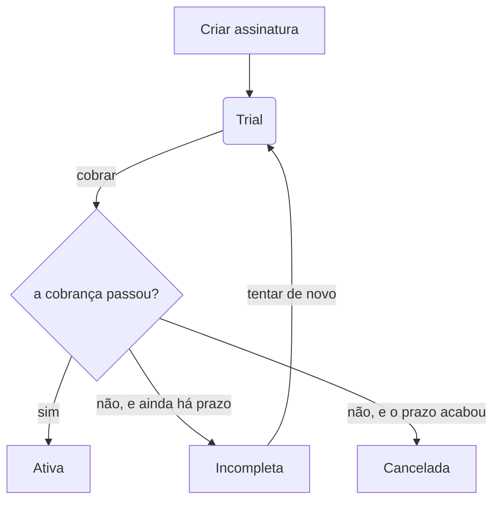

# subscription-api

O serviço de assinaturas do Codeflix: quem é o assinante, qual plano ele escolheu e se a cobrança
daquele mês passou. É ele que decide se alguém tem direito ao catálogo — a `videos-api` só serve o
que já está publicado, e nunca pergunta nada sobre pagamento.

Java 25, Spring Boot 4.1.1, Gradle 9.7.1. Pacote base `com.tarcisiolzbraga.codeflix.subscription`,
porta **8084**.

| | |
|---|---|
| Banco | MySQL 8.4 próprio, na porta 3307 |
| Persistência | JDBC com SQL escrito à mão, sem ORM |
| Autenticação | o mesmo realm do Keycloak dos outros serviços |
| Eventos | fila de saída no banco, lida pelo Debezium |

## O ciclo de vida de uma assinatura



A assinatura nasce em **trial** e vence em um mês. Na cobrança, passando, ela vira **ativa** e o
vencimento anda mais um mês; falhando, ela fica **incompleta** enquanto houver prazo de tolerância, e
é **cancelada** quando ele acaba. Cada passagem de estado registra um evento de domínio.

## Como rodar

A infraestrutura é a do monorepo, com o `.env` da raiz. Deste serviço o compose sobe dois
containers: a aplicação e o banco dela.

```bash
docker compose up -d subscription-mysql keycloak    # da raiz do monorepo
./gradlew bootRun                                   # a API, na 8084
```

Para rodar a aplicação em container também, empacote o jar antes — a imagem não compila:

```bash
./gradlew bootJar
docker compose up -d subscription-api               # da raiz do monorepo
```

```bash
./gradlew build                 # compila e roda tudo; porta de entrada de cada commit
./gradlew unitTests             # só os que não sobem container (dispensa Docker)
./gradlew integrationTests      # só @IntegrationTest
./gradlew e2eTests              # só @E2ETest
./gradlew bootJar               # build/libs/application.jar, na raiz do serviço
```

## Por que banco próprio

O MySQL da `admin-api` já existe, já tem binlog ligado e já tem o usuário do Debezium: um schema a
mais nele teria saído de graça. Ainda assim o banco aqui é outro container, pelo mesmo motivo que
levou o codificador a ter o Postgres dele:

- **O estado de um serviço não é assunto do outro.** Com um banco só, uma migration daqui alcança as
  tabelas de lá, e um `flyway clean` desatento apaga o catálogo inteiro.
- **Derrubar um não derruba o outro.** O banco da assinatura pode reiniciar, encher ou travar sem
  levar a administração do catálogo com ele.
- **O conector do Debezium fica menor.** Cada banco tem o seu, com a sua lista de tabelas, e o
  tópico de um não mistura evento do outro.

O preço está declarado: um container, um volume e um conector a mais, e o `CDC_USER` do `.env` passa
a ser criado nos dois bancos.

## Persistência sem ORM

Os agregados são salvos por SQL escrito à mão, com o `JdbcClient` do Spring. Não há entidade
espelhando a tabela nem contexto de persistência: o repositório lê o `ResultSet` direto para dentro
do agregado, pelo `with(...)` dele.

Duas consequências que valem registrar, porque mordem:

- **O lock otimista é explícito.** Cada tabela tem uma coluna `version`, e o update termina em
  `WHERE id = :id AND version = :version`. Zero linhas afetadas significa que alguém escreveu antes,
  e não que o id não existe.
- **Escrita precisa de commit.** O pool entrega a conexão com `auto-commit` **ligado**, ao contrário
  do da `admin-api`: lá o Hibernate abre transação em toda escrita, e aqui não há quem o faça. Com o
  auto-commit desligado, um update solto seria desfeito ao devolver a conexão, sem erro no log.
  Escrita que toca mais de uma tabela — o agregado mais a fila de eventos — declara `@Transactional`,
  e aí o gerenciador de transação desliga o auto-commit pelo tempo dela.

## Migrações

Mudança de schema é migration Flyway em `infrastructure/src/main/resources/db/migration`, nomeada
`V<n>__<descricao_em_snake_case>.sql`. O Flyway roda na subida da aplicação, pelo starter do Boot —
não há task `flywayMigrate` separada como na referência do curso.

Nunca editar migration já commitada: o checksum muda e o Flyway para em estado de reparação. O
ajuste é uma migration nova.

## Autenticação

O realm é o mesmo dos outros serviços, em `../provisioning/keycloak/realm.json`, e as roles que
importam aqui já existem lá: `CODEFLIX_ADMIN` e `CODEFLIX_SUBSCRIBER`.

A divisão das rotas é essa:

| Rota | Quem alcança |
|---|---|
| `POST /accounts/sign-up` | qualquer um, sem token |
| `/plans/**` | `CODEFLIX_ADMIN` |
| `/accounts/**`, `/subscriptions/**` | `CODEFLIX_ADMIN` ou `CODEFLIX_SUBSCRIBER` |
| a documentação da API | qualquer um (e em produção ela está desligada) |

O cadastro é a única rota aberta, e não poderia ser outra coisa: quem se cadastra ainda não tem
usuário no Keycloak para pedir um token — é justamente ele que cria o usuário lá.

A segurança fica ligada em **todos** os perfis, inclusive no `development`. A referência do curso a
desliga com `@Profile("!development")`, e isso deixaria o controle de acesso sem ser exercitado
justamente no ambiente em que se trabalha.

## Nota sobre o CDC

O usuário que o Debezium usa para ler o binlog nasce de `init/10-cdc-user.sh`, e o entrypoint da
imagem do MySQL **só executa esse script na criação do volume**. Em banco que já existe ele não
roda: nesse caso, rode o SQL à mão, ou recrie o volume com `docker compose down -v`, que apaga os
dados.
